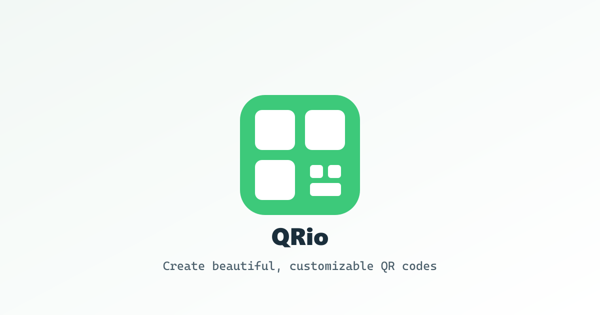

<h1>
  <picture>
    <source media="(prefers-color-scheme: dark)" srcset="data:image/svg+xml,%3Csvg xmlns='http://www.w3.org/2000/svg' width='40' height='40' viewBox='0 0 48 48'%3E%3Crect width='48' height='48' rx='10' fill='%233DC97A'/%3E%3Crect x='6' y='6' width='16' height='16' rx='3' fill='white'/%3E%3Crect x='26' y='6' width='16' height='16' rx='3' fill='white'/%3E%3Crect x='6' y='26' width='16' height='16' rx='3' fill='white'/%3E%3Crect x='30' y='30' width='5' height='5' rx='1' fill='white'/%3E%3Crect x='38' y='30' width='5' height='5' rx='1' fill='white'/%3E%3Crect x='30' y='38' width='13' height='5' rx='1' fill='white'/%3E%3C/svg%3E">
    
  </picture>
  QRio
</h1>

Create beautiful, customizable QR codes — free, offline, and private.

<a href="#features">Features</a> •
<a href="#getting-started">Getting Started</a> •
<a href="#usage">Usage</a> •
<a href="#stack">Stack</a> •
<a href="#configuration">Configuration</a> •
<a href="docs/README.md">Docs</a>

<p>
  
  
  
  
  
</p>

---

## Features

| Feature | Description |
|---|---|
| **8 QR Types** | URL, Wi-Fi, vCard, Email, SMS, Location, Text, Payment |
| **Custom Styles** | Square, Round, Diamond, Hex dot shapes |
| **Color fields** | Background, QR dot, and frame colors are modeled in `QRConfig`; the renderer currently uses the dot color only |
| **Frames** | Scan Me, Coffee, Dark Badge, Menu, Social — or no frame |
| **Center Icons** | Upload your logo or pick from 11 preset emojis |
| **Export** | PNG only at 512 / 1024 / 2048 px, copy to clipboard, or print — no SVG output |
| **Library** | Save, browse, edit, and restore QR codes (IndexedDB) |
| **PWA** | Installable, works offline with service worker caching |
| **Dark Mode** | Automatic theme toggle with persisted preference |
| **i18n** | Full English and Arabic (RTL) support |
| **Privacy** | QR data and library stay on-device; the page loads Nunito from Google Fonts |



## Visual identity

QRio uses a fresh green brand mark with mint surfaces and teal details. Its
optional dark mode retains the same green accent on forest-colored surfaces.

| Theme | Canvas / surface | Brand accent |
|---|---|---|
| Light | `#f2f8f5` / `#ffffff` | `#3DC97A` |
| Dark | `#0f1c14` / `#172112` | `#3DC97A` |

The image above is QRio's branded Open Graph visual rather than an app
screenshot. See the [visual identity guide](docs/visual-identity.md) and theme
source in [`src/style.css`](src/style.css).

## Getting Started

### Prerequisites

- **Node.js** ≥ 18
- **npm** ≥ 9

### Install

```bash
npm install
```

### Development

```bash
npm run dev
```

Starts the Vite dev server — open `http://localhost:5173` (or the port shown in the terminal).

### Production Build

```bash
npm run build
```

Type-checks with TypeScript and produces an optimized build in `dist/`.

### Preview Build

```bash
npm run preview
```

Serves the production build locally.

## Usage

1. **Pick a QR type** — URL, Wi-Fi, vCard, Email, SMS, Location, Text, or Payment.
2. **Enter your content** — the form adapts to the selected type.
3. **Customize the look** — choose colors, gradients, dot style, frame, and center icon.
4. **Export** — download as PNG (512 / 1024 / 2048 px), copy to clipboard, or print. There is no SVG export.

### QR Types

| Type | Fields |
|---|---|
| URL | Website URL |
| Wi-Fi | SSID, Password, Encryption (WPA/WEP) |
| vCard | Name, Phone, Email |
| Email | To, Subject, Body |
| Location | Latitude, Longitude |
| Text | Freeform text |
| SMS | Phone Number, Message |
| Payment | Payment string |

### Dot Styles

| Style | Preview |
|---|---|
| `square` | Standard square modules |
| `round` | Circular modules |
| `diamond` | Rotated square modules |
| `hex` | Hexagonal modules |

## Stack

| Layer | Library |
|---|---|
| Framework | [Vue 3](https://vuejs.org/) (Composition API, `<script setup>`) |
| Language | [TypeScript](https://www.typescriptlang.org/) |
| Build | [Vite](https://vite.dev/) |
| QR Generation | [`qrcode`](https://www.npmjs.com/package/qrcode) |
| Database | [IndexedDB](https://developer.mozilla.org/en-US/docs/Web/API/IndexedDB_API) via [`idb`](https://www.npmjs.com/package/idb) |
| PWA | [`vite-plugin-pwa`](https://www.npmjs.com/package/vite-plugin-pwa) (Workbox) |
| Fonts | [Nunito](https://fonts.google.com/specimen/Nunito) (Latin), [Cairo](https://fonts.google.com/specimen/Cairo) (Arabic) |

## Configuration

### `src/composables/useQR.ts`

The core `QRConfig` interface defines all customizable properties:

| Property | Type | Default | Description |
|---|---|---|---|
| `type` | `QrType` | `'url'` | QR content type |
| `dotStyle` | `DotStyle` | `'square'` | Module shape |
| `ecc` | `EccLevel` | `'Q'` | Error correction (L/M/Q/H) |
| `exportSize` | `ExportSize` | `1024` | PNG export resolution |
| `frame` | `FrameKey` | `'none'` | Frame / container preset |
| `transparent` | `boolean` | `false` | Transparent PNG background |
| `quietZone` | `boolean` | `true` | Include quiet zone border |

### PWA

The PWA manifest and service worker are configured in `vite.config.ts` via `vite-plugin-pwa`. The app caches the shell and QR generation assets for offline use.

## Lighthouse

Audited at **Performance 95% · Accessibility 77% · Best Practices 96% · SEO 82%**

> Scores from `dev/lighthouse.json`: Lighthouse 13.0.2 against
> `https://q-rio.vercel.app/`, fetched 2026-05-25T08:10:12.288Z. The `dev/`
> folder is gitignored, so this is a local snapshot rather than a tracked test.

## Internationalization

QRio ships with English (`en`) and Arabic (`ar`) translations. Language preference is persisted in `localStorage`.

- Toggle language from the navbar button
- Arabic uses RTL layout with the Cairo font
- Translations live in `src/composables/useI18n.ts`

## Project Structure

```
QRio/
├── public/
│   ├── favicon.svg        # App icon
│   ├── icons.svg          # Social/sharing icons
│   ├── icon-{192,512}.png # PWA icons
│   └── logo/
│       └── og-default.png # Open Graph image
├── src/
│   ├── components/        # Vue components
│   │   ├── NavBar.vue
│   │   ├── PreviewPanel.vue
│   │   ├── TabCreate.vue
│   │   ├── TabLibrary.vue
│   │   ├── TabSettings.vue
│   │   └── Toast.vue
│   ├── composables/       # Shared state & logic
│   │   ├── useDB.ts       # IndexedDB persistence
│   │   ├── useI18n.ts     # Internationalization
│   │   ├── useQR.ts       # QR config & generation
│   │   ├── useTheme.ts    # Dark/light theme
│   │   └── useToast.ts    # Toast notifications
│   ├── App.vue
│   ├── main.ts
│   └── style.css          # Global styles & CSS variables
├── dev/
│   └── qr-maker.html      # Early prototype / standalone QR maker
├── index.html
├── package.json
├── tsconfig.json
├── vite.config.ts
└── opencode.json
```

## Documentation

Full project docs are indexed in [`docs/README.md`](docs/README.md): product,
architecture, development, configuration, testing, deployment, changelog, and
the [visual identity guide](docs/visual-identity.md).

## Commands

| Script | Command | Purpose |
| --- | --- | --- |
| `dev` | `vite` | Start the Vite dev server |
| `build` | `tsc && vite build` | Type-check and build into `dist/` |
| `preview` | `vite preview` | Serve the built output locally |

Install with `npm install`. There is no `test`, `lint`, or `format` script.

## Known gaps

- No SVG/vector export; output is PNG only.
- Color and gradient fields exist in `QRConfig`, but the create form has no
  color controls and only the QR-dot gradient is honored by the renderer.
- `index.html` loads Nunito from Google Fonts, so the page makes an external
  request even though QR data stays on-device.
- No automated tests or CI; `npm run build` type-checks and bundles but runs no
  tests. See [testing](docs/testing.md).
- Local `dev/` artifacts (Lighthouse report, prototype) are gitignored.

## License

[MIT](LICENSE) © [Omar Khaled](https://github.com/Omar-Khaled-57)
